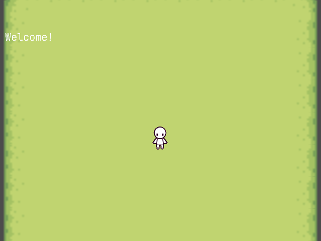

# R36S × Godot 3.5 农场风格 2D Demo —— 开发与上机指南（中文大白话版）

> 这是一个已经在真实 R36S 掌机上显示并玩起来的最小 Godot 3 项目：能用地、看角色、用十字键或左摇杆移动，作为后续游戏开发的模板。
>
> 2026-11-24 用户已确认掌机画面正常、游戏可玩。本文同时记录电脑端开发验证、FRT/PortMaster 上机流程，以及本项目 `.agent/skills/` 的游戏开发与素材生成工作流。

## 目录

1. [这个工程是什么](#1-这个工程是什么)
2. [快速开始](#2-快速开始)
3. [目录结构与文件职责](#3-目录结构与文件职责)
4. [场景结构](#4-场景结构)
5. [玩家控制逻辑](#5-玩家控制逻辑)
6. [动画资源](#6-动画资源)
7. [地图与瓦片](#7-地图与瓦片)
8. [关键配置速查](#8-关键配置速查)
9. [R36S / PortMaster 部署](#9-r36s--portmaster-部署)
10. [已知限制](#10-已知限制)
11. [二次开发指南](#11-二次开发指南)
12. [常见问题](#12-常见问题)
13. [Skill 与开发自动化](#13-skill-与开发自动化)
14. [从开发到上机的完整流程](#14-从开发到上机的完整流程)
15. [附录 A：数值速查](#附录-a数值速查)
16. [附录 B：术语](#附录-b术语)

---

## 1. 这个工程是什么

这是一个 **Godot 3.5 的 2D 俯视角小 Demo**：美术是一整套农场/生存题材的角色素材（空手、持斧头、锄头、钓竿、剑、盾等），但实际做出来的玩法只有 **四方向走路 + 待机动画**。

它被组织成 **PortMaster 掌机端口**的形式，目标设备是 **R36S**（640×480 屏），可以把它当成"把 Godot 3 游戏移植到 R36S 的最小可运行模板"，而不是一个完成品。

### 启动后能看到什么

- 一块 10×10 格的草地，外围是一圈可见且有碰撞的水；
- 一个角色站在草地正中间，相机平滑跟随并限制在水域范围内；
- 屏幕左上角一行 `Welcome!` 文字；
- 可以用 **W/A/S/D**、手柄左摇杆或掌机十字键走动，角色有上/下/左/右的走路和待机动画；
- 没有任何目标、交互、敌人、物品、声音、菜单或存档。



### 项目速览

| 项目 | 值 | 依据 |
|---|---|---|
| 工程名 | `demo` | `project.godot` |
| 引擎 | Godot **3.5.3**（PCK 头记录的版本） | `.build/demo/demo.pck` |
| 掌机运行时 | `frt_3.5.2`（与 3.5.3 同属 3.5.x） | `.build/demo.sh` |
| 脚本语言 | GDScript（Godot 3 语法） | `character/scripts/Player.gd` |
| 渲染后端 | GLES2；只启用 ETC1，未启用 ETC2 | `project.godot` |
| 设计分辨率 | 640×480，拉伸模式 `2d` | `project.godot` |
| 主场景 | `res://scenes/Game.tscn` | `project.godot` |
| 相机 | 挂在 `Player` 下，`zoom = 0.5`（Godot 3 里等于放大 2 倍），平滑跟随并限制在水域范围 | `scenes/Game.tscn:523-533` |
| 玩法脚本数量 | 1 个（`Player.gd`），没有任何其他 `.gd` | 全工程检索 |
| 音频 / UI / 存档 | 无 | 工程内无音频文件、无 UI 场景、无存档代码 |
| 目标设备 | R36S（PortMaster / Linux 掌机） | README、`demo.sh` |
| 导出预设 | Linux/X11、HTML5 | `export_presets.cfg` |
| 已构建产物 | `demo.pck`（25.67 MiB）+ 启动脚本 + 手柄映射 | `.build/` |
| 真机状态 | 2026-11-24 用户确认 R36S 画面正常、游戏可玩 | 上机验收 |
| 角色素材 | 78 张 PNG，约 35 MB，只有 2 张被场景引用 | `character/sprites/` |

---

## 2. 快速开始

### 2.1 在电脑上打开

1. 安装 **Godot 3.5.x**（推荐 3.5.3）。**不要用 Godot 4.x**：这个工程用的是 `KinematicBody2D`、`onready`、`AnimatedSprite`、`PoolIntArray` 等 Godot 3 API，4.x 打不开也跑不了。
2. 在项目管理器里导入本目录的 `project.godot`。
3. 首次打开会重新导入约 175 个资源到 `import/`，等进度条结束。
4. 按 **F5** 运行，主场景是 `scenes/Game.tscn`。

`addons/godot-git-plugin` 是编辑器里的 Git 插件，和游戏运行无关，可以忽略。

### 2.2 操作方式

| 操作 | 按键 / 输入 |
|---|---|
| 移动 | **W / A / S / D**（物理键位，按键盘位置识别，与输入法/布局无关） |
| 手柄（桌面调试） | 左摇杆 X/Y 轴，InputMap 死区 0.5，与键盘统一由 `Input.get_axis()` 读取 |
| 攻击 / 交互 / 暂停 / 菜单 | **没有绑定任何按键** |

注意：Godot 的 InputMap 没有直接绑定方向键；R36S 上由 `demo.gptk` 把十字键和左摇杆转成 W/A/S/D，所以掌机两种方向输入都能用。电脑上请用 WASD 或手柄左摇杆。

### 2.3 导出

| 预设 | 平台 | 预设输出路径 | 仓库里是否有产物 |
|---|---|---|---|
| `Linux/X11` | Linux 64 位 | `Build/demo.x86_64` | 没有 |
| `HTML5` | Web | `.build/demo.html` | 没有（只有 PCK） |

两个预设都是 `export_filter="all_resources"`，会把工程里所有资源一并导出。当前仓库里真正存在的是 `.build/demo/demo.pck`（给掌机运行时用的资源包）。

### 2.4 在 R36S 上运行

把文件按第 9 节的目录结构放到机器上即可；启动流程、按键映射和排障都在第 9 节。

---

## 3. 目录结构与文件职责

| 路径 | 内容 | 说明 |
|---|---|---|
| `project.godot` | 工程配置 | 主场景、窗口、渲染、输入映射、编辑器插件注册 |
| `export_presets.cfg` | 导出预设 | Linux/X11 + HTML5 |
| `default_env.tres` | 默认环境资源 | 里面是 ProceduralSky，主要面向 3D；当前 2D 画面基本用不到 |
| `README.md` | 中文大白话项目说明 | 玩法、开发、Skill、上机和发布流程 |
| `.agent/skills/engine-guide/` | Godot 3.5 / R36S / FRT 开发 Skill | 版本识别、GDScript、构建验证、PortMaster 部署 |
| `.agent/skills/asset-gen/` | apiz 优先的素材生成 Skill | Flare 图像、H3 视频、语音、音乐、本地 3D/动画工具 |
| `docs/FRT整合说明.md` | FRT 深入说明 | 版本、运行时、输入、退出、排障 |
| `docs/images/gameplay.png` | 实际运行截图 | README 展示与验收证据 |
| `r36s.md` | 脱敏后的连接与部署备忘 | 不保存密码或 API Key |
| `scenes/Game.tscn` | **唯一场景** | 相机、两块 TileMap、玩家、Welcome 文字 |
| `scenes/JetBrainsMono-VariableFont_wght.ttf` | 字体副本 | 与 `fonts/` 里那份 MD5 完全相同，场景未引用，属于重复文件 |
| `character/scripts/Player.gd` | **唯一脚本** | 玩家移动与动画切换 |
| `character/sprites/` | 78 张角色 PNG | 只有 `Character0_Idle.png`、`Character0_Walk.png` 被场景引用 |
| `map/tileset/` | 5 张瓦片图 | 只有 `Grass.png`、`Water.png` 被 TileSet 使用 |
| `fonts/JetBrainsMono-VariableFont_wght.ttf` | 字体 | `WelcomeText` 用的就是它 |
| `addons/godot-git-plugin/` | Godot Git 插件 v2.1.0 | 编辑器内做版本控制用，含 Windows/macOS/Linux 原生库（约 26 MB），不参与玩法 |
| `import/` | 当前导入缓存 | 175 个文件，Godot 自动生成；场景里的 `.import` 都指向这里 |
| `.import/` | 旧版导入缓存 | 24 个文件，含已经不存在的 `Idle.png`、`Walk.png`、`icon.png` 缓存，属于历史残留 |
| `.build/` | 掌机构建产物 | `demo.sh` 启动脚本、`demo/demo.pck`、`demo/demo.gptk` |

全工程约 388 个文件；其中 `character/sprites` 约 35 MB，`import/` 约 26 MB，`addons/` 约 26 MB。

> `import/` 和 `.import/` 都是生成物，已经由 `.gitignore` 忽略；删掉后下次打开编辑器会重新导入，属于正常现象。`.build/demo.pck`、`demo.sh`、`demo.gptk` 和 Skill 回归测试会保留在仓库中，API 冒烟任务与临时日志不会推送。

---

## 4. 场景结构

### 4.1 节点树

`scenes/Game.tscn` 的节点结构如下（括号内为关键属性）：

```text
Node2D（场景根）
├── Water（TileMap, visible = true, 水域碰撞）
│   └── Grass（TileMap）
├── Player（KinematicBody2D, script = Player.gd, _move_speed = 40）
│   ├── Camera2D（current = true, zoom = 0.5, 平滑跟随，限制在水域范围）
│   ├── Collision（CollisionShape2D）
│   └── AnimatedSprite（scale = 0.07）
└── WelcomeText（Label）
```

### 4.2 像素换算（很容易踩的坑）

Godot 3 的 `Camera2D.zoom` 与 Godot 4 **相反**：Godot 3 里 **数值越小越放大**，`zoom = 0.5` 表示 **放大 2 倍**（可视世界范围变成屏幕的一半）。

本工程的换算链：

| 层级 | 数值 | 换算 |
|---|---|---|
| 源瓦片 | 16×16 | `Grass.png` / `Water.png` 的原始像素 |
| 世界瓦片 | 32×32 | `Water` TileMap 节点 `scale = 2`，`Grass` 作为子节点继承缩放 |
| 屏幕瓦片 | 64×64 | 相机 `zoom = 0.5` 再放大 2 倍 |
| 可视世界范围 | 320×240 | 640×480 ÷ 2 |
| 草地 | 10×10 格 = 320×320 世界像素 | 屏幕上 640×640，正好铺满宽度，高度超出屏幕 160 像素 |
| 角色帧 | 460×460 → `scale 0.07` ≈ 32×32 世界像素 | 屏幕上约 64×64 |
| 移动速度 | 40 世界像素/秒 | 屏幕上 80 像素/秒，横穿一屏约 8 秒 |
| Welcome 字号 | 64 × `rect_scale 0.15885` ≈ 10 世界像素 | 屏幕上约 20 像素 |

这里特意用**节点缩放**而不是 `cell_custom_transform`：Godot 3 的 `cell_custom_transform` 只放大绘制，不会同步放大 TileMap 的碰撞形状和格子坐标。节点 `scale = 2` 会同时作用于绘制与碰撞，避免"看得见的水和撞不到的水"错位。

当前表现：

- 相机挂在 `Player` 下面，开启平滑跟随和地图边界限制，角色走动时画面会跟着移动。
- 水环现在可见且有碰撞，角色走到草地边缘会被水挡住，不会走进地图外。
- 水环外边界为 `x = -10..9`、`y = -8..7`，相机限制在这个范围内。

### 4.3 各节点说明

| 节点 | 类型 | 关键属性 | 作用 |
|---|---|---|---|
| `Camera2D` | Camera2D | `Player` 子节点，`zoom = (0.5, 0.5)`，平滑跟随，边界 `(-320,-256)..(320,256)` | 2 倍放大，镜头跟随角色并限制在水域范围内 |
| `Water` | TileMap | `visible = true`，`scale = (2,2)`，220 个格子，水 tile 有碰撞形状 | 围着草地的水边框，同时作为不可通行的地形 |
| `Grass` | TileMap | `Water` 子节点，继承 `scale = 2`，100 个格子，10×10 | 草地地面，全部可走 |
| `Player` | KinematicBody2D | 挂 `Player.gd`，`_move_speed = 40` | 玩家本体，起点在世界原点 |
| `Collision` | CollisionShape2D | 矩形 13×23，位置 `(-0.5, -6.5)` | 角色身体中下部的碰撞盒，与水碰撞配合实现阻挡 |
| `AnimatedSprite` | AnimatedSprite | `scale = (0.07, 0.07)`，6 个动画、42 帧 | 角色动画，默认 `idle_down` |
| `WelcomeText` | Label | 64 px 字体 × 0.15885 缩放，文本 `Welcome!` | 占位文字，换算到屏幕上大约在左上角 `(10, 12)` 处 |

### 4.4 地图数据形状

- **草地**：`x = -5..4`、`y = -5..4`，完整 10×10 矩形，共 100 格，全部可走。
- **水**：外框 `x = -10..9`、`y = -8..7`，共 220 格；中间留出完整的 `x = -5..4`、`y = -5..4` 10×10 区域给草地。原数据中与草地外圈重叠的 36 个水格已经移除。
- **碰撞**：水 tile 17 配置了 16×16 的矩形碰撞形状，经 `Water` 节点 2 倍缩放后是 32×32 世界像素，正好覆盖一个水格。草地没有碰撞，玩家可以在草地内自由移动，进入水格会被挡住。
- 草地以外的区域没有瓦片覆盖，露出视口底色；相机边界限制在水环外沿。

---

## 5. 玩家控制逻辑

全部逻辑在 `character/scripts/Player.gd`（55 行）。

### 5.1 执行流程

1. `_physics_process()` 每物理帧调用 `_move()`。
2. `_move()` 用 `Input.get_axis("move_left", "move_right")` 和 `Input.get_axis("move_up", "move_down")` 读取方向。
3. `Input.get_axis()` 会综合 InputMap 中绑定到这些动作的键盘和手柄轴，不需要再手动切换输入模式。
4. 方向向量归一化（斜向不会更快），乘以 `_move_speed`。
5. `move_and_slide(velocity)` 移动；Godot 3 内部会乘 delta，所以速度单位是"像素/秒"。
6. 有输入播放走路动画，无输入播放待机动画。
7. 撞到水域碰撞形状时，`move_and_slide` 会沿墙滑动并阻止角色进入水里。

### 5.2 函数职责

| 函数 | 行号 | 职责 |
|---|---|---|
| `_physics_process(delta)` | 9-10 | 每物理帧调用 `_move()`（`delta` 没有使用） |
| `_move()` | 12-25 | 读轴、归一化、移动、切动画 |
| `_play_walk_animation(dir)` | 27-44 | 按方向播放走路动画，处理左右翻转 |
| `_play_idle_animation()` | 46-55 | 按最后朝向播放待机动画 |

### 5.3 键盘与手柄的差异

| 输入源 | 读取方式 | 死区 | 特点 |
|---|---|---|---|
| 键盘 | `Input.get_axis()` 读取 InputMap 的 A/D/W/S | 无 | 数字输入，斜向由归一化保证速度一致 |
| 原生手柄 | `Input.get_axis()` 读取 InputMap 的轴 0/1 | InputMap 中配置 0.5 | 支持摇杆推杆幅度；按钮当前没有绑定任何动作 |
| 掌机 gptokeyb | 十字键和左摇杆都被转成 W/A/S/D | gptokeyb 自身有死区配置 | 对游戏来说仍然表现为键盘输入 |

去掉了原来的 `using_gamepad` 模式切换：只要收到一次手柄事件就永久切到手柄分支，在 gptokeyb 与 FRT 同时提供输入时容易造成"十字键时灵时不灵"。现在两种输入统一走 `Input.get_axis()`。

### 5.4 方向到动画的映射

走路：

| 移动方向 | 播放动画 | `flip_h` | 记录的 `last_direction` |
|---|---|---|---|
| 右 | `walk_left` | `true` | `right` |
| 左 | `walk_left` | `false` | `left` |
| 下 | `walk_down` | `false` | `down` |
| 上 | `walk_up` | `false` | `up` |

待机：

| 朝向 | 播放动画 | `flip_h` |
|---|---|---|
| 左 | `idle_left` | `false` |
| 右 | `idle_left` | `true` |
| 下 | `idle_down` | `false` |
| 上 | `idle_up` | `false` |

要点：

- **没有单独的"向右"动画资源**。向右走/站都用 `walk_left` / `idle_left` 水平翻转，`last_direction = "right"` 只是记录状态，动画名里没有 `right`。
- 当 `|x| == |y|`（正好斜向）时，`abs(dir.x) > abs(dir.y)` 为假，会走**垂直方向**分支，即上下优先。
- 键盘的"按下/松开"直接切换动画，没有过渡帧、没有加速度。

### 5.5 容易误解的地方

- **速度有两个值**：脚本默认 `_move_speed := 48.0`，但场景里把 `Player` 节点覆盖成了 **40.0**。实际运行时是 40。
- `_move_speed` 前面的下划线只是命名习惯，加了 `export` 后依然会在检查器里显示、可调。
- 在掌机上，`demo.gptk` 把十字键和左摇杆都映射成 W/A/S/D 键盘事件，所以两种掌机方向输入都能控制角色。
- 没有用到鼠标输入；A/B/X/Y 仍映射成鼠标左键，因此这些按钮在游戏里没有效果。
- `Start` 被映射成 Esc，启动器同时设置了 `FRT_EXIT_SHORTCUT=esc`，因此掌机上按 Start 可退出游戏；画面与移动已在真机确认，退出链路按 FRT 2.1.0 规则配置。

---

## 6. 动画资源

### 6.1 已接入的动画

场景只引用了两张图集：

| 文件 | 尺寸 | 网格 | 单帧 | 说明 |
|---|---|---|---|---|
| `Character0_Idle.png` | 3680×2300 | 8 列 × 5 行 | 460×460 | 只用了第 1、3、5 行（下/左/上），第 2、4 行未使用 |
| `Character0_Walk.png` | 2760×2300 | 6 列 × 5 行 | 460×460 | 只用了第 1、3、5 行（下/左/上），第 2、4 行未使用 |

`SpriteFrames` 里的 6 个动画（全部 `loop = true`，速度 10 fps）：

| 动画 | 帧数 | 来源 | 用途 |
|---|---|---|---|
| `idle_down` | 8 | Idle 第 1 行 | 朝下待机 |
| `idle_left` | 8 | Idle 第 3 行 | 朝左/朝右待机（右靠翻转） |
| `idle_up` | 8 | Idle 第 5 行 | 朝上待机 |
| `walk_down` | 6 | Walk 第 1 行 | 向下走 |
| `walk_left` | 6 | Walk 第 3 行 | 向左/向右走（右靠翻转） |
| `walk_up` | 6 | Walk 第 5 行 | 向上走 |

合计引用 42 帧。每帧 460×460，精灵缩放 0.07 后约 32×32 世界像素，正好等于一格世界瓦片。

### 6.2 已经准备好但没接进游戏的动作

`character/sprites/` 共有 78 张图，除了上面两张，其余 **76 张都没有被场景引用**。素材覆盖了完整的一套农场角色状态：

| 动作 | 素材情况 | 是否已接入 |
|---|---|---|
| 待机 / 走路（空手） | 有 | **已接入** |
| 待机 / 走路 + 8 种工具 | 有 | 未接入 |
| 奔跑 `Run`（空手 + 7 种工具） | 有 | 未接入 |
| 挖掘 `Dig`（含铲子版） | 有 | 未接入 |
| 钓鱼 `Fish`（含钓竿版） | 有 | 未接入 |
| 挥砍 `Swing`（斧 / 锤 / 镐） | 有 | 未接入 |
| 剑击 `SwordAttack` | 有 | 未接入 |
| 交互 `Interact`、坐下 `Sit`、起身 `GetUp`、受伤 `Damage` | 有，含工具变体 | 未接入 |
| 死亡 `Die` | 有 | 未接入 |

可用工具共 8 种：斧头（Axe）、钓竿（FishingPole/Fishingpole）、锤子（Hammer）、镐（PickAxe/Pickaxe）、盾（Shield）、铲子（Showel）、剑（Sword）、水壶（WaterCan）。

> 文件命名不统一：`FishingPole` 和 `Fishingpole`、`PickAxe` 和 `Pickaxe` 混用；铲子拼成了 `Showel`（正确拼写是 Shovel）；还额外有一张 `WalkHoldingTool_Silver.png`。写代码批量加载时要按实际文件名来，别按单词猜。

### 6.3 新增一个动作的步骤

1. 把新图集放进 `character/sprites/`，确认导入完成；
2. 在 `Game.tscn` 里选中 `Player/AnimatedSprite`，打开 `SpriteFrames`；
3. 新建动画（如 `run_down`），按 460×460 网格切 `AtlasTexture` 加帧，设置 fps 和 loop；
4. 在 `Player.gd` 里增加状态判断，`anim_sprite.play("run_" + 方向)`。

如果要做工具切换，最简单的做法是每个工具一套 `SpriteFrames`，切工具时整体替换 `anim_sprite.frames`；所有工具图集的帧网格必须保持一致，否则动画会错位。

---

## 7. 地图与瓦片

### 7.1 图集清单

| 文件 | 尺寸 | 16 px 网格 | 是否使用 |
|---|---|---|---|
| `Grass.png` | 176×112 | 11×7 | 使用（TileSet 里定义了 16 个草地 tile） |
| `Water.png` | 64×16 | 4×1 | 使用（只定义了第 1 帧） |
| `Tileset Spring.png` | 192×320 | 12×20 | 未使用 |
| `Tilled_Dirt.png` | 176×112 | 11×7 | 未使用 |
| `Walls and Floors copiar.png` | 144×176 | 9×11 | 未使用 |

TileSet 一共定义了 17 个 tile：

- 草地 tile id `1`–`16`，其中 id `3` 和 id `4` 指向同一个图块（`Rect2(0, 16, 16, 16)`），id `4` 实际没用到；
- 水 tile id `17`，只取 `Water.png` 的 `(0, 0, 16, 16)`，所以水是静态的，另外 3 帧没有接入；
- 地图实际用到的草地 id 是 `1, 2, 3, 5, 6, 7, 8, 9, 10`，共 9 种；
- 草地 tile `1`–`16` 没有碰撞形状；水 tile `17` 配置了覆盖整格的 16×16 矩形碰撞形状。

### 7.2 地图构成

| 层 | 范围（格） | 数量 | 可见性 |
|---|---|---|---|
| Grass | `x = -5..4`，`y = -5..4` | 100（10×10） | 可见 |
| Water | `x = -10..9`，`y = -8..7` 的外框，扣除与草地重叠的 36 格 | 220 | 可见，有碰撞 |

水的形状是"回"字形：上下各 4 行是整行，中间 8 行只保留左右各 5 列，中间空出完整的 10×10 区域给草地。

草地在屏幕上是 640×640，宽度正好等于屏幕，因此：

- 左右走到草地边缘 = 走到屏幕边缘；
- 继续走就会离开可视区域；
- 上下还有约 80 屏幕像素的余量（草地比屏幕高 160 像素，上下各 80）。

---

## 8. 关键配置速查

### 8.1 `project.godot`

| 配置 | 值 | 含义 |
|---|---|---|
| `application/config/name` | `demo` | 工程名 |
| `application/run/main_scene` | `res://scenes/Game.tscn` | 启动场景 |
| `display/window/size/width` | `640` | 设计宽度 |
| `display/window/size/height` | `480` | 设计高度 |
| `display/window/stretch/mode` | `2d` | 2D 拉伸模式 |
| `rendering/quality/driver/driver_name` | `GLES2` | 面向低功耗掌机的渲染后端 |
| `vram_compression/import_etc` | `true` | 启用 ETC1 |
| `vram_compression/import_etc2` | `false` | 未启用 ETC2 |
| `boot_splash/show_image` | `false` | 关闭启动图 |
| `editor/version_control_plugin_name` | `GitAPI` | 编辑器加载 Git 插件 |
| 输入动作 | 4 个 | 只有上/下/左/右 |

`default_env.tres` 里配置了 ProceduralSky，但这套环境主要面向 3D，当前 2D 画面基本看不到它的效果。

### 8.2 输入映射

| 动作 | 键盘（物理扫描码） | 手柄 |
|---|---|---|
| `move_left` | A | 轴 0，负方向 |
| `move_right` | D | 轴 0，正方向 |
| `move_up` | W | 轴 1，负方向 |
| `move_down` | S | 轴 1，正方向 |
| 统一死区 | — | 0.5 |

没有 `interact`、`attack`、`pause`、`ui_*` 等自定义动作。

### 8.3 导出预设

| 预设 | 平台 | 输出路径 | 关键选项 |
|---|---|---|---|
| `Linux/X11` | Linux 64 位 | `Build/demo.x86_64` | 不内嵌 PCK；S3TC 开，ETC/ETC2 关 |
| `HTML5` | Web | `.build/demo.html` | 画布自适应；PWA 关闭 |

两个预设都是：

- `export_filter="all_resources"`：导出所有资源；
- `script_export_mode=1`：脚本以二进制 token 形式导出（PCK 里是 `Player.gdc` + `.remap`）。

当前仓库没有上述两个路径的完整产物，只有掌机用的 `demo.pck`。

---

## 9. R36S / PortMaster 部署

### 9.1 放文件

`.build/` 里的东西对应到掌机上的位置：

```text
/roms/ports/
├── demo.sh                 ← 来自 .build/demo.sh
└── demo/
    ├── demo.pck            ← 来自 .build/demo/demo.pck
    ├── demo.gptk           ← 来自 .build/demo/demo.gptk
    └── log.txt             ← 运行时自动生成
```

### 9.2 `demo.sh` 做了什么

脚本是标准的 PortMaster 启动器，流程如下：

1. 在 4 个常见位置里找 PortMaster 目录（`/opt/system/Tools/PortMaster`、`/opt/tools/PortMaster`、`$XDG_DATA_HOME/PortMaster`、`/roms/ports/PortMaster`）。
2. 加载 `control.txt`、`device_info.txt`，以及当前 CFW 的 `mod_${CFW_NAME}.txt`。
3. 调用 `get_controls` 准备 SDL 手柄配置。
4. 设定 `GAMEDIR=/roms/ports/demo`，把 `XDG_CONFIG_HOME` / `XDG_DATA_HOME` 指到游戏目录下的 `conf`。
5. 把 stdout/stderr 同时写入 `GAMEDIR/log.txt`。
6. 指定运行时 `frt_3.5.2`；如果 `frt_3.5.2.squashfs` 不存在，会调用 `harbourmaster` 下载。
7. 把运行时 squashfs 挂载到 `~/godot` 并加入 `PATH`。
8. 开放 `/dev/uinput`，启动 `gptokeyb`（用 `demo.gptk`），然后执行：

   ```bash
   frt_3.5.2 $GODOT_OPTS --main-pack demo.pck
   ```

9. 游戏退出后卸载运行时、杀掉 `gptokeyb`、重启 `oga_events`、清屏。

脚本还做了三项兼容处理：

- 同时设置旧版 `FRT_NO_EXIT_SHORTCUTS=1` 和新版 `FRT_EXIT_SHORTCUT=esc`，分别适配 FRT 2.0.x / 2.1.0+；
- 在 `$GODOT_OPTS` 后追加 `--video-driver GLES2`，明确走本工程使用的 GLES2 渲染后端；
- 消耗 PortMaster 提供的 `$GODOT_OPTS`。

### 9.3 掌机按键映射（`demo.gptk`）

| 掌机按键 | gptokeyb 映射成 | 游戏内实际效果 |
|---|---|---|
| 十字键 上/下/左/右 | W / S / A / D | **移动** |
| 左摇杆 上/下/左/右 | W / S / A / D | **移动** |
| A / B / X / Y | 鼠标左键 | 无（没有绑定动作） |
| R1 / R2 | 鼠标左键 | 无 |
| L1 / L2 | 鼠标减速 | 无 |
| Select / back | Enter | 无 |
| Start | Esc | **退出游戏**（FRT 2.1.0+，由 `FRT_EXIT_SHORTCUT=esc` 处理） |

掌机上现在十字键和左摇杆都能移动角色。A/B/X/Y、R1/R2、L1/L2、Select 仍然没有游戏内动作，属于预留按键。

### 9.4 构建产物里有什么

`demo.pck` 的关键信息：

| 项目 | 值 |
|---|---|
| 文件数 | 175 |
| 总大小 | 26,913,696 字节（25.67 MiB） |
| 贴图导入产物 | 26,425,118 字节，约占 98.2% |
| 引擎版本 | 3.5.3 |
| 脚本 | `res://character/scripts/Player.gdc`（编译后的脚本） |
| 插件 | 只带了 Git 插件的 `gdnlib`/`gdns` 描述（596 字节），没有原生库 |

因为导出过滤是 `all_resources`，**76 张没用到的动作图也全部打进了 PCK**，这是包体达到 25 MB 的主要原因。

### 9.5 更新游戏

1. 在 Godot 3.5 里重新导出 PCK（Export PCK/Zip），或重新导出 Linux 版本后取其中的 PCK；
2. 替换 `/roms/ports/demo/demo.pck`；
3. 重启 EmulationStation / 重新启动端口；
4. 出问题先看 `/roms/ports/demo/log.txt`。

PCK 是 3.5.3 导出的，掌机运行时是 3.5.2，同属 3.5.x，正常情况下兼容；如果换运行时，建议两边版本对齐。

---

## 10. 已知限制

1. **只有移动和动画**：没有游戏循环、交互、战斗、采集、物品、NPC、敌人、任务。
2. **水是静态的**：`Water.png` 有 4 帧，但 TileSet 只用了第 1 帧。
3. **76 张动作素材未接入**：奔跑、挖掘、钓鱼、挥砍、剑击、交互、坐下、受伤、死亡等都只有图，没有逻辑。
4. **没有向左/向右的独立动画**：右方向靠 `flip_h` 复用左方向动画。
5. **没有声音**：工程里没有任何音频文件。
6. **没有 UI / 存档 / 设置**：左上角 `Welcome!` 是占位文字，不是菜单。
7. **生成物已忽略**：项目已接入 Git，`import/`、`.import/`、API 冒烟任务和临时日志不会推送；源码、Skill、文档与掌机 PCK 会保留。
8. **字体重复**：`fonts/` 和 `scenes/` 各有一份相同的字体文件，场景只引用 `fonts/` 那份。
9. **两个导出预设都没有完整产物**：仓库里只有掌机 PCK。
10. **PCK 偏大**：绝大部分是导入贴图，其中多数贴图当前场景用不到。
11. **速度配置容易看错**：脚本默认 48，场景覆盖成 40，实际以场景为准。

---

## 11. 二次开发指南

### 11.1 建议的推进顺序

相机跟随、地形碰撞、地图显示、掌机方向输入已经完成，并已在真实 R36S 上确认可玩。下一步按功能推进：

1. **增加输入动作**：在 Project Settings → Input Map 里加 `run`、`interact`、`attack`，再在 `Player.gd` 里做状态切换。
2. **接入现成动作**：优先接 `Run`、`Interact`、`Dig`、`Fish`、`Swing`，这些图都齐了，只缺动画状态和逻辑。
3. **工具系统**：用 8 套 `HoldingTool` 图集，切换工具时替换 `SpriteFrames`；注意帧网格保持一致。
4. **地图扩展**：`Tileset Spring.png`、`Tilled_Dirt.png`、`Walls and Floors copiar.png` 已经在 `map/tileset/`，可以直接扩 TileSet 做季节、耕地、房屋。
5. **补外围系统**：音频、背包/UI、存档、NPC、敌人、任务。当前工程没有任何相关基础，需要从零搭。
6. **减小包体**：把导出过滤从 `all_resources` 改成"只导出选中场景及其依赖"，或把 76 张未使用图集移出工程；也可以先把 460 帧的 PNG 预缩到实际使用尺寸。

### 11.2 改代码前先确认

- **不要升级到 Godot 4**：节点名、API、相机 zoom 语义都变了，这个工程是按 3.5 写的。
- **注意相机 zoom**：Godot 3 里 `0.5` 是放大 2 倍；改成 `2` 反而是缩小 2 倍。
- **注意帧网格**：新增动画必须按 460×460 切帧，否则会串图。
- **注意左右共用动画**：向右没有独立素材，别去找 `walk_right` / `idle_right`。
- **注意掌机输入层**：加手柄按钮动作时，除了 Godot 的 InputMap，还要改 `demo.gptk`，否则掌机上收不到事件。
- **保持 GLES2 + ETC1**：这两个设置是给低功耗掌机做的兼容选择，改渲染后端前先在真机验证。
- **注意分辨率**：所有 UI 和相机参数都按 640×480 设计；改窗口尺寸要重新算可视范围。

---

## 12. 常见问题

**Q：打开工程提示版本不支持 / 场景报错？**
A：必须用 Godot **3.5.x**。4.x 不兼容 Godot 3 的场景和 API。

**Q：资源变成粉色、或者提示找不到 `.stex`？**
A：让编辑器重新导入。`import/` 是当前缓存，`.import/` 是旧版残留；两者都是生成物，删掉后重启编辑器会重建（重建需要一点时间）。

**Q：掌机上黑屏 / 闪退 / 没反应？**
A：先看 `/roms/ports/demo/log.txt`；再确认 PortMaster 的 `frt_3.5.2.squashfs` 是否可用、`gptokeyb` 是否正常启动。缺运行时时 `demo.sh` 会尝试用 `harbourmaster` 下载。

**Q：为什么掌机左摇杆不能走路？**
A：旧版 `demo.gptk` 把左摇杆映射成了鼠标；现在已经改成 W/A/S/D，和十字键一样能控制角色。如果更新后仍不能走，检查掌机上的 `demo.gptk` 是否还是旧文件。

**Q：为什么 A/B/X/Y 按了没反应？**
A：它们被映射成鼠标左键，而且游戏没有绑定任何鼠标/按钮动作。

**Q：为什么看不到水？**
A：旧版把 `Water` TileMap 的 `visible` 关掉了；现在已经打开，水环会显示在草地外侧，并带有碰撞。

**Q：为什么角色会走出画面？**
A：旧版相机固定在原点；现在 `Camera2D` 已挂在 `Player` 下面，会平滑跟随角色，并限制在水域范围内。

**Q：为什么 PCK 有 25 MB？**
A：导出设置为 `all_resources`，78 张角色图集（其中 76 张未使用）全部打进了包。改导出过滤或移除未使用素材可以显著减小。

**Q：HTML5 怎么没有产物？**
A：`export_presets.cfg` 里只是配置了 HTML5 预设，仓库里没有导出过网页版；需要自己用 Godot 3.5 的 Web 导出模板导一次。

**Q：怎么改移动速度？**
A：选中 `Player` 节点，改检查器里的 `_move_speed`（当前 40）。脚本默认值是 48。

**Q：怎么让角色有碰撞？**
A：当前水 tile 已经配置了碰撞形状，玩家会被水挡住。要给其他地形加碰撞，按同样方式在 TileSet 对应 tile 上添加形状；节点缩放必须同时作用于绘制和碰撞，不能只用 `cell_custom_transform` 放大绘制。

---

## 13. Skill 与开发自动化

本仓库把 `.agent/skills/` 一并开源。它们不是游戏运行依赖，而是后续继续开发时给 AI 助手使用的操作手册和工具。

| Skill | 负责什么 | 什么时候用 |
|---|---|---|
| `engine-guide` | 识别 Godot 版本，维护 Godot 3.5/GDScript/R36S/FRT 规则，给出构建、截图、PCK 导出和 PortMaster 部署步骤 | 改场景、脚本、输入、渲染或部署时 |
| `asset-gen` | 通过本机 apiz CLI 生成图像、视频、语音、音乐和声音设计；同时保留本地 Blender、Tripo、godogen_assets 路线 | 补角色、地图、动画、音效或音乐时 |

### 13.1 当前素材默认路线

- 图像：`apiz/gpt-image-2.6-flare`。普通图像优先用 Flare，不主动推荐 Sunburst。
- 视频：`minimax/h3`（MiniMax-H3）为默认；`st-ai/super-seed2` 仍可显式选择，二者按各自 schema 工作。
- 语音：`speech-2.8-hd`；声音设计：`minimax/voice-design`；音乐：`minimax/music-gen`。
- 免费/本地路线：`godogen_assets`、Blender、Tripo 和自定义动画工具仍保留，按项目需要选择。

### 13.2 使用 asset-gen

```bash
ASSET_SKILL=".agent/skills/asset-gen"
APIZ="$ASSET_SKILL/scripts/apiz_asset.py"

python "$APIZ" doctor
python "$APIZ" models --category video --search h3
python "$APIZ" docs minimax/h3
```

API Key 只保存在本机 apiz profile 或环境变量中，不提交到 Git。每次付费生成都会写 `<输出文件>.apiz.json`，记录任务号、参数和真实费用；相同命令会续查原任务，`--force` 才会重新付费提交。

H3 文生视频示例：

```bash
python "$APIZ" video \
  --prompt "A tiny farm robot waves hello, fixed camera, clean game-cinematic style" \
  --duration 4 --resolution 480p --aspect-ratio 16:9 \
  -o .build/robot_wave.mp4
```

H3 首尾帧示例：

```bash
python "$APIZ" video \
  --prompt "The character completes a steady wave, consistent colors and lighting" \
  --first-frame assets/img/first.png --last-frame assets/img/last.png \
  --duration 5 --resolution 768P --aspect-ratio 16:9 \
  -o assets/video/wave.mp4
```

需要 Seedance 时显式指定：

```bash
python "$APIZ" video --model st-ai/super-seed2 \
  --prompt "A slow cinematic push-in" \
  --image assets/img/first.png --image assets/img/last.png \
  --duration 5 --aspect-ratio 16:9 --variant fast \
  -o assets/video/intro_seedance.mp4
```

运行包装器回归测试：

```bash
python .build/test_apiz_wrapper.py
```

当前测试覆盖 H3 默认值、原生 `content` 数组、首尾帧与混合参考上传、参数边界、Seedance 兼容、续跑请求哈希、媒体下载和批次失败退出码。

## 14. 从开发到上机的完整流程

### 14.1 电脑端开发与验证

1. 用 **Godot 3.5.3** 打开 `project.godot`，不要用 Godot 4。
2. 修改 `scenes/Game.tscn` 或 `character/scripts/Player.gd`。
3. 先让编辑器完成资源导入，再运行主场景。
4. 命令行验证时，在 Git Bash 中可指定本机 Godot 3.5.3：

```bash
GODOT="/path/to/Godot_v3.5.3-stable_win64.exe"

"$GODOT" --version
"$GODOT" --headless --path . --editor --quit
"$GODOT" --headless --path . \
  --script res://character/scripts/Player.gd --check-only
"$GODOT" --headless --path . --no-window --quit
```

Godot 3 的某些脚本错误只写日志、不返回非零退出码，所以不能只看退出码；日志里出现 `SCRIPT ERROR`、`ERROR:`、解析失败或资源缺失都必须处理。

### 14.2 导出掌机 PCK

Godot 3.5 的 `--export-pack` 不需要二进制导出模板：

```bash
mkdir -p .build/demo
"$GODOT" --headless --path . \
  --export-pack "Linux/X11" ".build/demo/demo.pck"

sha256sum .build/demo/demo.pck
```

导出预设保留在 `export_presets.cfg`。当前使用 `all_resources`，所以未接入的角色动作图也会进包，PCK 约 25.67 MiB。

### 14.3 推送到 R36S

先查询掌机当前 IP，并通过 SSH 正常核对主机密钥。密码不写进命令或仓库：

```bash
export R36S_HOST="ark@<R36S_IP>"

scp .build/demo.sh "$R36S_HOST:/roms/ports/demo.sh"
scp .build/demo/demo.pck .build/demo/demo.gptk "$R36S_HOST:/roms/ports/demo/"

ssh "$R36S_HOST" 'chmod +x /roms/ports/demo.sh && ls -lh /roms/ports/demo/demo.pck'
```

如果没有 `scp`，可用 PuTTY 的 `pscp` 执行同样复制操作。设备路径、SSH 注意事项和验收清单见 [r36s.md](r36s.md)。

### 14.4 上机验收

从 EmulationStation 启动 `demo`，逐项确认：

- 草地、水环、角色和 `Welcome!` 正常显示；
- 十字键与左摇杆都能四方向移动；
- 角色被水挡住，相机跟随；
- 按 Start 走 Esc 退出链路；
- 日志没有脚本、资源或运行时错误。

```bash
ssh "$R36S_HOST" 'tail -n 80 /roms/ports/demo/log.txt'
```

更完整的版本对应关系、输入链路和排障说明见 [docs/FRT整合说明.md](docs/FRT整合说明.md)。

### 14.5 发布到 GitHub

仓库地址：

```text
https://github.com/liangdabiao/r36s-godot-dev.git
```

首次配置并推送：

```bash
git remote add origin https://github.com/liangdabiao/r36s-godot-dev.git
git branch -M main
git push -u origin main
```

提交前确认没有密码、API Key、私钥或本机路径；`import/`、`.import/`、`.build/apiz-smoke/` 和临时日志已被 `.gitignore` 排除。

## 附录 A：数值速查

| 项目 | 数值 |
|---|---|
| 设计分辨率 | 640×480 |
| 拉伸模式 | 2d |
| 相机 zoom | 0.5（Godot 3 语义 = 放大 2 倍） |
| 可视世界范围 | 320×240 |
| 源瓦片 | 16×16 |
| 世界瓦片 | 32×32（`Water` 节点 `scale = 2`，`Grass` 继承） |
| 屏幕瓦片 | 64×64 |
| 草地 | 10×10 格，100 格，全部可走 |
| 水外框 | 220 格，中间 10×10 空洞，带碰撞 |
| 玩家速度 | 40 世界像素/秒（屏幕 80 像素/秒） |
| 玩家碰撞盒 | 13×23 世界像素 |
| 角色帧 | 460×460，缩放 0.07 |
| 已接入动画 | 6 个，42 帧，10 fps |
| 角色素材 | 78 张 PNG，2 张已用，76 张未用 |
| 字体 | JetBrains Mono，64 px × 0.15885 |
| PCK | 175 个文件，25.67 MiB |
| PCK SHA-256 | `f71356b0e021b76717683bc04e5921c041e3971eb7a2fe71f02c1461a5f261e9` |
| 引擎版本 | PCK 3.5.3 / 运行时 frt_3.5.2 |

## 附录 B：术语

| 术语 | 在这里指什么 |
|---|---|
| Godot 3.5 | 本工程使用的引擎大版本；场景格式、GDScript 语法、相机 zoom 语义都按 3.x |
| GLES2 | 兼容性更好的渲染后端，适合低功耗掌机 |
| ETC1 / ETC2 | 两种移动端纹理压缩格式；本工程只开 ETC1 |
| TileMap / TileSet | 瓦片地图节点 / 瓦片图集资源 |
| KinematicBody2D | Godot 3 的 2D 运动体节点，用 `move_and_slide` 移动 |
| AnimatedSprite | 逐帧动画节点，本工程用 `SpriteFrames` 管理 6 个动画 |
| PCK | Godot 的资源包，运行时通过 `--main-pack` 加载 |
| FRT | 掌机上用的 Godot 运行时（这里是 `frt_3.5.2`） |
| PortMaster | 掌机上的端口管理工具，负责运行时、手柄映射和启动脚本 |
| gptokeyb | 把掌机手柄事件转换成键盘/鼠标事件的工具 |


## 特别致谢

https://linux.do 社区支持