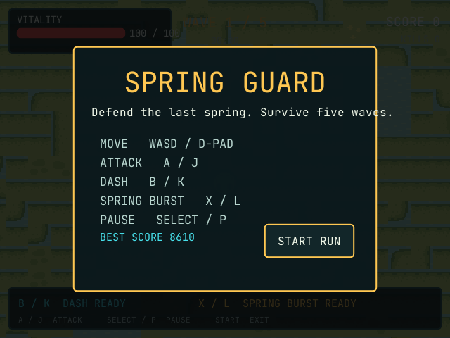
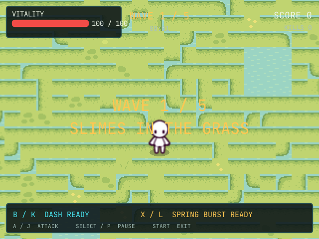
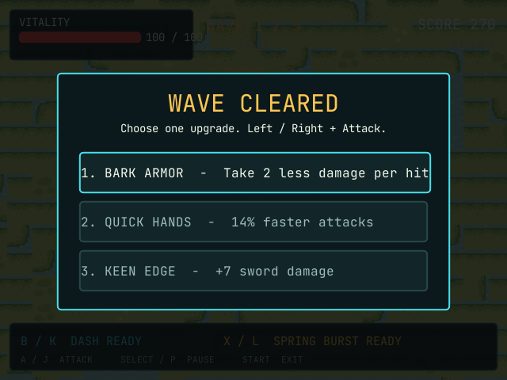
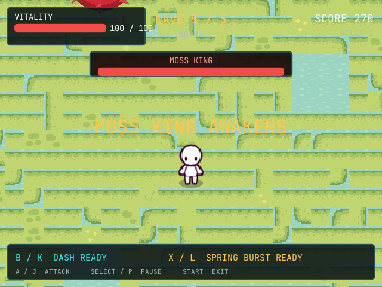
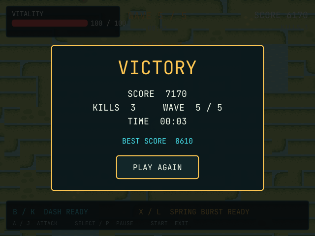

# Spring Guard（清泉守卫）—— R36S × Godot 3.5 完整小游戏开发与上机指南

> 本工程已经从"只能走路的移动演示"扩展成一个**完整可玩的 2D 动作守卫小游戏**：五波敌人、三种小怪、最终 Boss、剑击 / 闪避 / 范围技能、波间三选一升级、连击计分、掉落回血、暂停 / 胜负结算、最高分存档和合成音效。
>
> 目标设备是 **R36S**（640×480 屏，PortMaster / FRT 运行时）。电脑端用 **Godot 3.5.3** 开发，掌机用 `frt_3.5.2` 运行，同属 3.5.x。
>
> 2026-11-24 状态：玩法回归 **24 项全部通过**，新 PCK 已导出并通过 `--main-pack` 独立加载验证；标题 / 战斗 / 升级 / Boss / 结算截图已核对。掌机部署与验收流程见第 7、10 节。

## 目录

1. [游戏是什么](#1-游戏是什么)
2. [快速开始](#2-快速开始)
3. [目录结构与文件职责](#3-目录结构与文件职责)
4. [玩法与数值](#4-玩法与数值)
5. [场景、素材与音效](#5-场景素材与音效)
6. [输入映射](#6-输入映射)
7. [R36S / PortMaster 部署](#7-r36s--portmaster-部署)
8. [已知限制](#8-已知限制)
9. [Skill 与素材生成](#9-skill-与素材生成)
10. [从开发到上机的完整流程](#10-从开发到上机的完整流程)
11. [发布到 GitHub](#11-发布到-github)
12. [附录 A：数值速查](#附录-a数值速查)
13. [附录 B：术语](#附录-b术语)

---

## 1. 游戏是什么

**Spring Guard（清泉守卫）** 是一个俯视角单屏动作游戏：你扮演守卫，在草地竞技场上挡住五波进攻，最后击败 Boss **Moss King**。

一局游戏的完整循环：

1. 标题界面显示操作说明和历史最高分，按攻击键或 START RUN 开始；
2. 进入第 1 波，敌人从场地边缘生成并追向你；
3. 用剑击清怪，闪避躲冲锋，范围技能清场；
4. 击杀掉宝石（加分）和心（回血），连续击杀叠连击倍率；
5. 清完一波弹出**三选一升级**，选完进入下一波；
6. 第 5 波出现 Boss，半血狂暴并召唤小怪；
7. 击败 Boss 胜利，或血量归零失败，结算界面显示分数 / 击杀 / 波次 / 用时 / 最高分；
8. 最高分写入本地存档，下次启动仍在。

### 实际运行截图

以下截图均由 `.build/capture_game.gd` 在 Godot 3.5.3 真实渲染后导出，不是示意图。

| 标题界面 | 战斗 / HUD |
|---|---|
|  |  |

| 波间升级 | Boss 战 | 胜利结算 |
|---|---|---|
|  |  |  |

### 项目速览

| 项目 | 值 | 依据 |
|---|---|---|
| 工程名 | `Spring Guard` | `project.godot` |
| 引擎 | Godot **3.5.3** | 本机验证 |
| 掌机运行时 | `frt_3.5.2` | `.build/demo.sh` |
| 脚本语言 | GDScript（Godot 3 语法） | `game/*.gd`、`character/scripts/Player.gd` |
| 渲染后端 | GLES2，ETC1 开 / ETC2 关 | `project.godot` |
| 设计分辨率 | 640×480，拉伸模式 `2d` | `project.godot` |
| 主场景 | `res://scenes/Game.tscn` | `project.godot` |
| 玩法脚本 | `Game.gd`、`Player.gd`、`Enemy.gd`、`Pickup.gd`、`EffectsLayer.gd`、`HUD.gd` | `game/`、`character/scripts/` |
| 音频 | 9 个本地合成 WAV | `assets/audio/` |
| 存档 | `user://spring_guard.cfg` | `game/Game.gd` |
| 导出预设 | Linux/X11、HTML5 | `export_presets.cfg` |
| 掌机产物 | `demo.pck` 745,856 字节（约 728 KiB） | `.build/demo/demo.pck` |
| PCK SHA-256 | `5f60d4bbbc54abcabaf1683f4b4c7c6b066d6f849765e5cc5aa06673ad99db3a` | `sha256sum` |

---

## 2. 快速开始

### 2.1 在电脑上运行

1. 安装 **Godot 3.5.x**（推荐 3.5.3）。**不要用 Godot 4.x**：工程用的是 `KinematicBody2D`、`onready`、`yield`、`PoolVector2Array`、`update()` 等 Godot 3 API。
2. 项目管理器导入本目录 `project.godot`，等资源导入完成。
3. 按 **F5** 运行，主场景 `scenes/Game.tscn`。

命令行验证（Git Bash，按本机实际路径改 `GODOT`）：

```bash
GODOT="/c/Users/49707/AppData/Local/Temp/godot-3.5.3/Godot_v3.5.3-stable_win64.exe"

# 启动检查：日志里不能有 SCRIPT ERROR
"$GODOT" --headless --path . --no-window --quit

# 玩法回归：24 项检查，退出码 0 表示全过
"$GODOT" --headless --path . --script res://.build/test_game.gd

# 截图：会短暂弹窗，输出到 docs/images/game_*.png
"$GODOT" --path . --script res://.build/capture_game.gd

# 导出掌机 PCK（不需要二进制导出模板）
"$GODOT" --headless --path . --export-pack "Linux/X11" .build/demo/demo.pck
```

> Godot 3 的某些运行时错误只写日志、退出码仍为 0，所以**必须看日志**，不能只看退出码。

### 2.2 操作方式

| 动作 | 电脑键盘 / 鼠标 | 掌机按键 |
|---|---|---|
| 移动 | W / A / S / D | 十字键或左摇杆 |
| 剑击 | J / 空格 / 鼠标左键 | A 或 Y（R1 备用） |
| 闪避 | K | B（R2 / L2 备用） |
| 范围技能 Spring Burst | L / E | X（L1 备用） |
| 暂停 / 恢复 | P | Select |
| 确认 / 开始 / 重开 | 攻击键或 Enter | A |
| 升级界面选择 | 左右方向键 + 攻击确认，或 1 / 2 / 3 直选 | 十字键左右 + A |
| 退出游戏 | Esc | Start |

暂停界面里按闪避键可以直接重开一局。胜负结算后按攻击键再来一局。

### 2.3 重新生成角色图集和音效

角色大图集和音效都由入库脚本生成，不依赖临时目录：

```bash
python tools/build_game_assets.py
```

它会从 `character/sprites/Character0_*.png` 裁缩出 48px 横向图集到 `assets/sprites/`，并合成 9 个 22050Hz 单声道 WAV 到 `assets/audio/`。改完素材后让 Godot 重新导入再导出 PCK。

---

## 3. 目录结构与文件职责

| 路径 | 内容 | 说明 |
|---|---|---|
| `project.godot` | 工程配置 | 主场景、640×480、GLES2、输入映射 |
| `export_presets.cfg` | 导出预设 | Linux/X11 输出 `.build/demo/demo.pck`；排除旧大图集 / addons / tools / docs / .agent / .build |
| `scenes/Game.tscn` | 主场景 | 游戏总管 + 玩家 + 相机 + 碰撞盒 |
| `game/Game.gd` | 游戏总管 | 状态机、波次、生成、计分、升级、存档、音效、震屏 |
| `game/Enemy.gd` | 敌人 | slime / bat / brute / boss 的 AI、冲锋、狂暴、程序化绘制 |
| `game/Pickup.gd` | 掉落物 | 宝石 / 心，吸附、收集、过期闪烁 |
| `game/EffectsLayer.gd` | 特效层 | 打击火花、伤害数字、剑光、范围环 |
| `game/HUD.gd` | 界面 | 血条 / 波次 / 分数 / 连击 / 冷却 / Boss 条 / 标题 / 升级 / 暂停 / 结算 |
| `game/GameFont.tres` | 字体资源 | JetBrains Mono DynamicFont |
| `character/scripts/Player.gd` | 玩家 | 移动、剑击、闪避、技能、受伤、升级、动画 |
| `assets/sprites/` | 5 张 48px 玩家图集 | idle / run / attack / hurt / die，各 3 方向 |
| `assets/audio/` | 9 个 WAV | swing / hit / hurt / dash / pickup / special / wave / win / lose |
| `map/tileset/` | 瓦片图 | 运行时用 `Grass.png`、`Water.png` 建 TileSet |
| `fonts/` | JetBrains Mono | HUD 与特效文字 |
| `tools/build_game_assets.py` | 素材生成脚本 | 裁缩图集 + 合成音效，路径按 `__file__` 推导 |
| `.build/test_game.gd` | 玩法回归 | 24 项检查，覆盖完整一局 |
| `.build/capture_game.gd` | 截图脚本 | 顺序导出 5 个状态截图 |
| `.build/demo.sh` | PortMaster 启动器 | 找运行时、挂 squashfs、起 gptokeyb、跑 PCK |
| `.build/demo/demo.pck` | 掌机资源包 | 745,856 字节 |
| `.build/demo/demo.gptk` | 掌机按键映射 | 十字键 / 摇杆 → WASD，A/B/X/Y → J/K/L |
| `.agent/skills/engine-guide/` | Godot 3.5 / R36S / FRT Skill | 版本识别、构建验证、部署 |
| `.agent/skills/asset-gen/` | apiz 素材生成 Skill | Flare 图像、H3 视频、语音 / 音乐 |
| `docs/FRT整合说明.md` | FRT 深入说明 | 运行时、输入、退出、排障 |
| `docs/images/` | 实际截图 | README 展示与验收证据 |
| `r36s.md` | 脱敏连接备忘 | 不保存密码或 API Key |
| `character/sprites/` | 原始 78 张角色 PNG | 只作为生成脚本输入，**不进 PCK** |
| `addons/godot-git-plugin/` | 编辑器 Git 插件 | 不参与玩法，不进 PCK |

`import/`、`.import/` 是 Godot 生成缓存，已被 `.gitignore` 忽略；删掉后重新打开编辑器会重建。

---

## 4. 玩法与数值

以下数值均按当前源码核对。

### 4.1 玩家基础属性

| 属性 | 值 | 来源 |
|---|---|---|
| 移动速度 | 108 像素/秒 | `Player.gd` |
| 最大生命 | 100 | `Player.gd` |
| 剑击伤害 | 24 | `Player.gd` |
| 攻击间隔 | 0.38 秒 | `Player.gd` |
| 攻击范围 | 50 像素（加敌人半径） | `Player.gd` / `Game.gd` |
| 闪避冷却 | 1.15 秒 | `Player.gd` |
| 闪避速度 / 持续 | 340 / 0.16 秒 | `Player.gd` |
| 技能冷却 | 6 秒 | `Player.gd` |
| 技能伤害 / 半径 | 46 / 112 像素 | `Player.gd` / `Game.gd` |
| 受击无敌 | 0.72 秒 | `Player.gd` |
| 护甲减伤 | 每次受击减 armor，至少保留 1 点伤害 | `Player.gd` |

剑击是前方扇形判定：距离 ≤ 攻击范围 + 敌人半径，且方向点积 > 0.18。闪避期间短暂无敌。范围技能以玩家为中心 112 像素内全体受伤。

### 4.2 敌人

| 类型 | 生命 | 速度 | 接触伤害 | 击杀分 | 半径 | 行为 |
|---|---|---|---|---|---|---|
| slime | 26 + 波次×4 | 48 + 波次×2 | 7 + 波次 | 80 + 波次×10 | 11 | 直线追踪 |
| bat | 20 + 波次×3 | 72 + 波次×3 | 6 + 波次 | 100 + 波次×12 | 9 | 高速追踪 |
| brute | 52 + 波次×6 | 36 + 波次×1.5 | 12 + 波次 | 160 + 波次×18 | 15 | 蓄力冲锋 |
| boss | 460 | 42 | 18 | 1800 | 25 | 追踪 + 冲锋 + 狂暴召唤 |

- 第 2 波起有 42% 概率出 bat；第 3 波起有 22% 概率出 brute；其余为 slime。
- brute 冲锋：触发距离 145，蓄力 0.65 秒，冲锋 0.40 秒 / 速度 245，冷却 2.4 秒。蓄力时有红圈预警。
- Boss 半血（≤230）狂暴：伤害 +3、速度 ×1.12、冲锋更快，并召唤 2 只 bat。致死伤害不会同时触发狂暴。
- 敌人出生有 0.35 秒缩放保护，期间不可被攻击；接触伤害冷却 0.85 秒。
- 同屏活跃敌人上限 **16**。

### 4.3 波次

| 波次 | 数量 | 名称 |
|---|---|---|
| 1 | 5 | SLIMES IN THE GRASS |
| 2 | 8 | QUICK WINGS |
| 3 | 11 | HEAVY FOOTSTEPS |
| 4 | 14 | THE LAST DEFENSE |
| 5 | 5（含 Boss） | MOSS KING |

生成间隔：前 4 波 0.62 秒，第 5 波 0.85 秒。清完一波后等 0.75 秒进入升级 / 胜利。敌人从场地边缘生成，尽量离玩家 >135 像素。

### 4.4 升级（8 选 3）

| id | 名称 | 效果 |
|---|---|---|
| damage | KEEN EDGE | 剑击伤害 +7 |
| attack_speed | QUICK HANDS | 攻击间隔 ×0.86（最低 0.18） |
| move_speed | LIGHT STEP | 移速 +13 |
| max_hp | STRONG HEART | 最大生命 +22，并回复 30 |
| dash | WIND STEP | 闪避冷却 ×0.82（最低 0.45），持续 +0.015 |
| special | SPRING POWER | 技能冷却 ×0.80（最低 2.4），伤害 +10 |
| armor | BARK ARMOR | 每次受击减 2 |
| leech | LIFE DEW | 每次击杀回复 1.5 |

每波结束固定回复 10 点生命。升级可叠加，次数记录在 `player.upgrades`。

### 4.5 连击、掉落与计分

- 连击窗口 **3.2 秒**，窗口内连续击杀倍率 +1，最高 **x5**；超时归零。
- 击杀掉落宝石：加 `12 × 当前连击` 分；拾取宝石会刷新连击窗口。
- 18% 概率或 brute 必掉心：回复 18。
- Boss 死亡额外 +500 分，掉 2 个心各回复 30。
- 胜利额外 +1000 分。
- 最高分存 `user://spring_guard.cfg` 的 `records/best_score`。

---

## 5. 场景、素材与音效

### 5.1 竞技场

- 草地 30×22 格（`x = -15..14`，`y = -11..10`），16px 瓦片，随机草花装饰。
- 外圈水带碰撞，两个 3×3 小水池。
- 相机挂在玩家下，`zoom = 0.5`（Godot 3 语义 = 放大 2 倍），平滑跟随，限制 `±256 / ±192`。
- 场地边界 `Rect2(-232, -168, 464, 336)`；敌人生成边缘 `±218 / ±154`。
- 受击 / 技能 / Boss 死亡触发屏幕震动，强度随时间衰减。

### 5.2 玩家图集

原始 460×460 角色帧由 `tools/build_game_assets.py` 裁缩为 **48×48**，每方向 3 行拼成横向图集：

| 文件 | 帧数/方向 | 用途 |
|---|---|---|
| `player_idle.png` | 8 | 待机 |
| `player_run.png` | 4 | 跑动 |
| `player_attack.png` | 6 | 剑击 / 技能 |
| `player_hurt.png` | 2 | 受伤 |
| `player_die.png` | 6 | 死亡 |

向右没有独立素材，靠 `flip_h` 复用左方向。敌人、掉落、特效用轻量程序化绘制，不占贴图内存。

### 5.3 音效

9 个本地合成 WAV（22050Hz 单声道）：swing、hit、hurt、dash、pickup、special、wave、win、lose。游戏用 8 个 `AudioStreamPlayer` 轮询播放，避免同帧音效互相打断。没有背景音乐。

---

## 6. 输入映射

### 6.1 Godot InputMap

| 动作 | 键盘 | 手柄 |
|---|---|---|
| move_left/right/up/down | A/D/W/S | 轴 0/1 + D-pad 按钮 14/15/12/13 |
| attack | J / 空格 / 鼠标左键 | 按钮 0 |
| dash | K | 按钮 1 |
| special | L / E | 按钮 2 |
| pause | P | 按钮 9 |

摇杆死区 0.5。键盘和手柄统一由 `Input.get_axis()` / `Input.is_action_just_pressed()` 读取。

### 6.2 掌机 gptokeyb（`demo.gptk`）

| 掌机按键 | 映射成 | 游戏效果 |
|---|---|---|
| 十字键 / 左摇杆 | W/S/A/D | 移动 |
| A / Y / R1 | J | 剑击 |
| B / R2 / L2 | K | 闪避 |
| X / L1 | L | 范围技能 |
| Select / back | P / Enter | 暂停 / 确认 |
| Start | Esc | 退出（FRT 退出快捷键） |

启动器同时设 `FRT_NO_EXIT_SHORTCUTS=1` 和 `FRT_EXIT_SHORTCUT=esc`，兼容 FRT 2.0.x / 2.1.0+。**暂停用 Select，不用 Start**，避免和退出冲突。

---

## 7. R36S / PortMaster 部署

### 7.1 放文件

```text
/roms/ports/
├── demo.sh                 ← .build/demo.sh
└── demo/
    ├── demo.pck            ← .build/demo/demo.pck
    ├── demo.gptk           ← .build/demo/demo.gptk
    └── log.txt             ← 运行时自动生成
```

### 7.2 启动脚本做了什么

1. 在 4 个常见位置找 PortMaster，加载 `control.txt` / `device_info.txt` / CFW mod。
2. `get_controls` 准备 SDL 手柄配置；`GAMEDIR=/roms/ports/demo`，配置目录指到 `conf`。
3. stdout/stderr 写入 `log.txt`。
4. 运行时 `frt_3.5.2`；缺 squashfs 时调 `harbourmaster` 下载。
5. 挂载 squashfs 到 `~/godot`，加入 PATH。
6. 设 FRT 退出变量，追加 `--video-driver GLES2`。
7. 开放 `/dev/uinput`，起 `gptokeyb -c ./demo.gptk`，执行 `frt_3.5.2 $GODOT_OPTS --main-pack demo.pck`。
8. 退出后卸载运行时、杀 gptokeyb、重启 oga_events、清屏。

### 7.3 PCK 信息

| 项目 | 值 |
|---|---|
| 大小 | 745,856 字节（约 728 KiB） |
| SHA-256 | `5f60d4bbbc54abcabaf1683f4b4c7c6b066d6f849765e5cc5aa06673ad99db3a` |
| 引擎 | 3.5.3 导出 / frt_3.5.2 运行 |
| 主场景 | `res://scenes/Game.tscn` |
| 脚本 | 编译为 `.gdc` + `.remap` |

旧移动演示 PCK 约 25.67 MiB，因为 `all_resources` 把 76 张未用大图集也打进去了。现在导出预设排除了 `character/sprites/Character0_*`、`addons/*`、`tools/*`、`docs/*`、`.agent/*`、`.build/*`，只带实际用到的 48px 图集、瓦片、字体、音效和脚本，包体降到约 728 KiB。

### 7.4 更新游戏

1. 电脑端改代码 / 素材，跑回归和启动检查；
2. 重新 `--export-pack "Linux/X11" .build/demo/demo.pck`；
3. 替换掌机 `/roms/ports/demo/demo.pck`（映射或启动器改了也要一起替换）；
4. 重启端口；出问题先看 `/roms/ports/demo/log.txt`。

### 7.5 上机验收清单

- 标题界面、操作说明、最高分正常显示；
- 十字键和左摇杆都能移动，A 剑击、B 闪避、X 技能、Select 暂停、Start 退出；
- 五波推进、升级三选一、Boss 狂暴、胜负结算正常；
- 血条 / 分数 / 连击 / 冷却 / Boss 条刷新正确；
- 帧率流畅、无明显卡顿，日志无 SCRIPT ERROR / 资源缺失。

---

## 8. 已知限制

1. **游戏内 UI 是英文**：当前 JetBrains Mono 字体不含中文字形；README 和文档仍中文。要中文 UI 需换含 CJK 的字体。
2. **没有背景音乐**：只有 9 个合成音效。
3. **敌人 / 掉落 / 特效是程序化绘制**：风格统一但不是手绘素材；要更精细可接 asset-gen 生成贴图。
4. **单屏竞技场**：没有关卡切换、剧情、NPC、商店。
5. **向右动画复用左方向**：靠 `flip_h`，没有独立右向素材。
6. **水是静态的**：`Water.png` 有多帧但只用第 1 帧。
7. **HTML5 预设没有产物**：仓库只导出掌机 PCK；网页版需自行用 Godot 3.5 Web 模板导出。
8. **字体有重复副本**：`fonts/` 和 `scenes/` 各一份相同字体，场景只引用 `fonts/`。
9. **真机验收待完成**：桌面回归与 PCK 加载已验证；R36S 实机按键 / 帧率 / 内存需按第 7.5 节逐项确认。

---

## 9. Skill 与素材生成

本仓库把 `.agent/skills/` 一并开源。它们不是游戏运行依赖，而是后续开发时给 AI 助手用的操作手册和工具。

| Skill | 负责什么 | 什么时候用 |
|---|---|---|
| `engine-guide` | Godot 3.5 / GDScript / R36S / FRT 规则，构建、截图、PCK 导出、PortMaster 部署 | 改场景、脚本、输入、渲染或部署时 |
| `asset-gen` | 本机 apiz CLI 生成图像 / 视频 / 语音 / 音乐 / 声音设计；保留本地 Blender、Tripo、godogen_assets | 补角色、地图、动画、音效或音乐时 |

### 9.1 当前素材默认路线

- 图像：`apiz/gpt-image-2.6-flare`。普通图像优先 Flare，不主动推荐 Sunburst。透明 GIF 按 Flare 真实 schema：透明 PNG 关键帧本地组装，不发不支持的 transparent-GIF 参数。
- 视频：`minimax/h3`（MiniMax-H3）默认；`st-ai/super-seed2`（Seedance）仍可显式选择。H3 支持文生视频、首尾帧、图片/视频/音频混合参考。
- 语音：`speech-2.8-hd`；声音设计：`minimax/voice-design`；音乐：`minimax/music-gen`。
- 免费/本地路线：`godogen_assets`、Blender、Tripo、自定义动画工具仍保留。

### 9.2 使用 asset-gen

```bash
ASSET_SKILL=".agent/skills/asset-gen"
APIZ="$ASSET_SKILL/scripts/apiz_asset.py"

python "$APIZ" doctor
python "$APIZ" models --category video --search h3
python "$APIZ" docs minimax/h3
```

API Key 只在本机 apiz profile 或环境变量，不提交 Git。每次付费生成写 `<输出文件>.apiz.json` 记录任务号、参数、真实费用；相同命令续查原任务，`--force` 才重新付费提交。

H3 文生视频示例：

```bash
python "$APIZ" video \
  --prompt "A tiny guardian defends a spring, fixed camera, clean game-cinematic style" \
  --duration 4 --resolution 480p --aspect-ratio 16:9 \
  -o .build/guardian.mp4
```

需要 Seedance 时显式指定 `--model st-ai/super-seed2`，并按 Seedance schema 传参；不要把 H3 的 `content` 和 Seedance 的 `functionMode` / `filePaths` 混用。

包装器回归：

```bash
python .build/test_apiz_wrapper.py
```

覆盖 H3 默认值、原生 content 数组、首尾帧与混合参考上传、参数边界、Seedance 兼容、续跑请求哈希、媒体下载和批次失败退出码。

---

## 10. 从开发到上机的完整流程

### 10.1 电脑端开发与验证

1. Godot 3.5.3 打开 `project.godot`，不要用 Godot 4。
2. 改 `game/*.gd`、`character/scripts/Player.gd`、`scenes/Game.tscn` 或素材。
3. 素材改了先跑 `python tools/build_game_assets.py`，再让 Godot 重新导入。
4. 启动检查 + 玩法回归：

```bash
GODOT="/c/Users/49707/AppData/Local/Temp/godot-3.5.3/Godot_v3.5.3-stable_win64.exe"
"$GODOT" --headless --path . --no-window --quit
"$GODOT" --headless --path . --script res://.build/test_game.gd
```

回归覆盖：标题、开始、第一波生成、正面剑击、玩家受伤、闪避冷却、技能冷却、清波升级、三选一、升级生效、暂停/恢复、推进到第五波、Boss 生成、半血狂暴、击败 Boss 胜利、分数/击杀/最高分。

5. 需要看画面时跑截图脚本，检查 `docs/images/game_*.png`：

```bash
"$GODOT" --path . --script res://.build/capture_game.gd
```

### 10.2 导出掌机 PCK

```bash
"$GODOT" --headless --path . --export-pack "Linux/X11" .build/demo/demo.pck
sha256sum .build/demo/demo.pck
```

`--export-pack` 不需要二进制导出模板。导出后建议再用 `--main-pack .build/demo/demo.pck --quit` 验证包能独立加载。

### 10.3 推送到 R36S

先查掌机当前 IP，SSH 用已记录主机密钥核对，**不要**盲目 `StrictHostKeyChecking=no`。密码不写进命令、仓库或日志：

```bash
export R36S_HOST="ark@<R36S_IP>"

scp .build/demo.sh "$R36S_HOST:/roms/ports/demo.sh"
scp .build/demo/demo.pck .build/demo/demo.gptk "$R36S_HOST:/roms/ports/demo/"
ssh "$R36S_HOST" 'chmod +x /roms/ports/demo.sh && ls -lh /roms/ports/demo/demo.pck'
```

没有 `scp` 可用 PuTTY `pscp`。设备路径、SSH 注意事项见 [r36s.md](r36s.md)。

### 10.4 上机验收

从 EmulationStation 启动 `demo`，按第 7.5 节清单逐项确认，并看日志：

```bash
ssh "$R36S_HOST" 'tail -n 80 /roms/ports/demo/log.txt'
```

更完整的版本对应、输入链路和排障见 [docs/FRT整合说明.md](docs/FRT整合说明.md)。

---

## 11. 发布到 GitHub

仓库地址：

```text
https://github.com/liangdabiao/r36s-godot-dev.git
```

首次配置并推送：

```bash
git remote add origin https://github.com/liangdabiao/r36s-godot-dev.git
git branch -M main
git push -u origin main
```

提交前确认没有密码、API Key、私钥或本机敏感路径；`import/`、`.import/`、Python 字节码、API 冒烟任务和临时日志已被 `.gitignore` 排除。`.agent/`、README、FRT/R36S 文档、验证脚本和掌机 PCK 会保留在仓库中。

---

## 附录 A：数值速查

| 项目 | 数值 |
|---|---|
| 设计分辨率 | 640×480 |
| 拉伸模式 | 2d |
| 相机 zoom | 0.5（Godot 3 = 放大 2 倍） |
| 相机限制 | ±256 / ±192 |
| 草地 | 30×22 格，16px 瓦片 |
| 场地边界 | Rect2(-232, -168, 464, 336) |
| 玩家速度 / 生命 / 伤害 | 108 / 100 / 24 |
| 攻击间隔 / 范围 | 0.38 秒 / 50 |
| 闪避冷却 / 速度 / 持续 | 1.15 秒 / 340 / 0.16 秒 |
| 技能冷却 / 伤害 / 半径 | 6 秒 / 46 / 112 |
| 波次数量 | 5 / 8 / 11 / 14 / 5 |
| 同屏敌人上限 | 16 |
| 连击窗口 / 上限 | 3.2 秒 / x5 |
| Boss 生命 / 狂暴阈值 | 460 / ≤50% |
| 玩家图集帧 | 48×48 |
| 音效 | 9 个 WAV，22050Hz 单声道 |
| PCK 大小 | 745,856 字节（约 728 KiB） |
| PCK SHA-256 | `5f60d4bbbc54abcabaf1683f4b4c7c6b066d6f849765e5cc5aa06673ad99db3a` |
| 引擎 | 3.5.3 导出 / frt_3.5.2 运行 |

## 附录 B：术语

| 术语 | 在这里指什么 |
|---|---|
| Godot 3.5 | 本工程引擎大版本；场景格式、GDScript、相机 zoom 语义都按 3.x |
| GLES2 | 兼容性更好的渲染后端，适合低功耗掌机 |
| ETC1 / ETC2 | 移动端纹理压缩格式；本工程只开 ETC1 |
| TileMap / TileSet | 瓦片地图节点 / 瓦片图集资源 |
| KinematicBody2D | Godot 3 的 2D 运动体，用 `move_and_slide(velocity)` 移动 |
| AnimatedSprite | 逐帧动画节点，用 `SpriteFrames` 管理 |
| PCK | Godot 资源包，运行时 `--main-pack` 加载 |
| FRT | 掌机 Godot 运行时（`frt_3.5.2`） |
| PortMaster | 掌机端口管理工具，负责运行时、手柄映射、启动脚本 |
| gptokeyb | 把掌机手柄事件转成键盘/鼠标事件的工具 |

---

## 特别致谢

https://linux.do 社区支持