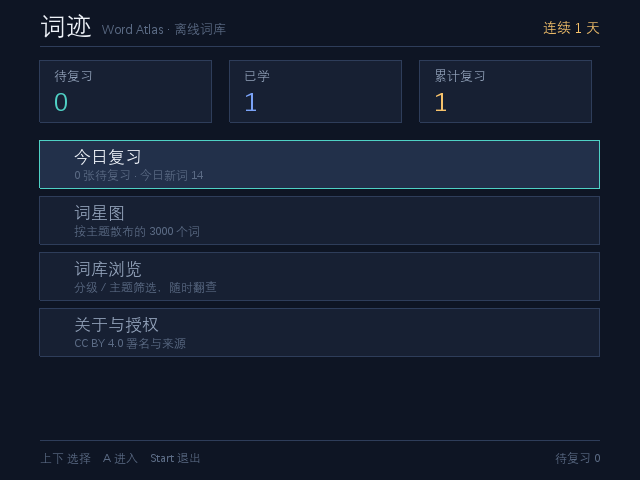
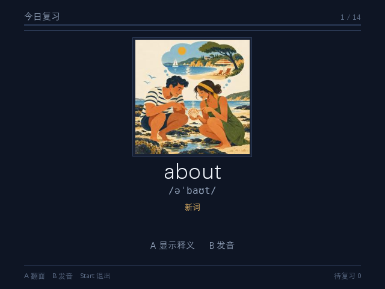
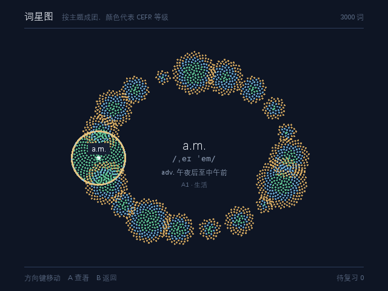
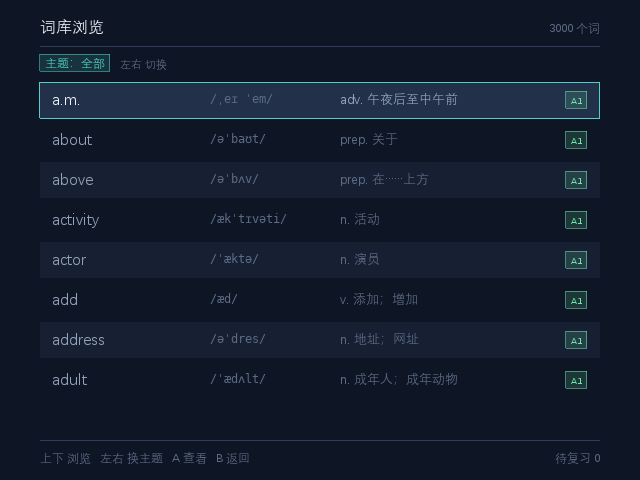
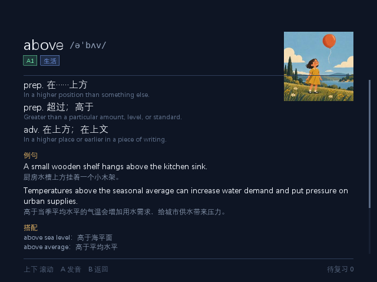

# Word Atlas Buddy · 词迹

R36S 掌机（ArkOS / PortMaster / Godot 3.5.2）上的离线英语词库学习应用。

内容改编自 [Word Atlas](https://github.com/designfuchen/word-atlas)，**3,000 词**，
带插画与英音，用 FSRS-6 算法安排复习。



---

## 它是什么

| 项 | 值 |
|---|---|
| 词条 | 3,000（CEFR A1、A2 全量 1,824 + B1 按 19 主题均衡补齐 1,176） |
| 每词内容 | 词形、IPA 音标、多义项中文释义、英文释义、例句 + 译文、搭配、词族、近/反义词、易混提示 |
| 插画 | 3,000 张 256×256 JPEG（上游 512px WebP 转码） |
| 发音 | 3,000 个单词英音 + 4,004 条例句录音（原生 64 kbps 单声道，零再编码） |
| 复习算法 | FSRS-6（`ts-fsrs` 6.0.1 的 1:1 移植，已对拍验证） |
| 包体 | PCK **207 MB**（插画 3,000 张 + 两批例句录音） |
| 屏幕 | 640×480 固定布局，纯手柄操作 |
| 运行时 | Godot 3.5.2 / GLES2 / 1 GB RAM |

## 界面

| | |
|---|---|
|  |  |
| 首页：待复习 / 已学 / 累计统计，四个入口 | 复习正面：插画 + 单词 + 音标，按 A 翻面 |
|  |  |
| 复习背面：释义 + 例句 + 搭配 + 提示，四档评分 | 词星图：19 个主题成团，环心显示当前词 |
|  |  |
| 词库浏览：按主题筛选 | 词条详情：完整释义、例句、词族、学习状态 |

## 操作

| 按键 | 功能 |
|---|---|
| 上下左右 | 移动焦点 / 滚动 / 评分选择 |
| A | 确认 / 翻面 |
| B | 返回 |
| Y | 播放单词发音 |
| X | 播放例句①（复习页需先翻面） |
| L1 | 播放例句② |
| Start | 保存并退出 |

按键映射见 `word-atlas-buddy.gptk`（方向=WASD，A=J，B=K，X=L，Y=U，L1=Q，R1=R）。

> 底栏每个界面都会画出当前可用按键，不用记。

## 构建

```bash
# 1. 拉取内容并转码（首次约 30 分钟，可断点续跑）
python tools/prepare_content.py all

# 2. 重建中文字体子集（词库约 2,760 个汉字）
python tools/build_font.py

# 3. 导出 PCK
godot --path . --export-pack "Linux/X11" .build/word-atlas-buddy.pck
```

依赖：Python 3 + Pillow + fontTools、ffmpeg、Godot 3.5.3（导出用；设备上跑 3.5.2）。

### 中间产物

```
.cache/upstream/     上游原始文件缓存（可随时删除，重跑会补）
raw/img/*.jpgraw     3,000 张转码后的插画（扩展名故意非标准）
raw/aud/*.mp3raw     3,000 个单词英音
raw/ex/*.mp3raw      2,995 条例句录音（第一批）
raw/ex2/*.mp3raw     1,009 条例句录音（第二批）
data/index.json      3,000 行精简索引（190 KB）
data/chunks/NN.json  30 个词条块，每块 100 词（共 2.7 MB）
```

> **音频不做二次编码。** 上游已经是 64 kbps 单声道 MP3，转成 32 kbps 听感会变成
> 发闷的沙沙声。管线里 `convert_audio()` 是 `shutil.copyfile`，一比一搬运。

> **`.jpgraw` / `.mp3raw` 不是笔误。** Godot 会把 `.jpg`、`.mp3` 当资源导入，
> 3,000 张图经 ETC1 压缩后会膨胀到 90 MB 以上；用 Godot 不认识的扩展名可以
> 让它们以原始字节进包，运行时用 `Image.load_jpg_from_buffer()` /
> `AudioStreamMP3.data` 直接读。**千万不要加 `.gdignore`** —— 那会让 Godot
> 完全不扫描该目录，连打包都会漏掉（PCK 会缩到 4 MB，媒体全丢）。

## 测试

```bash
# 数据完整性 + FSRS 排程 + 存档往返，19 项检查
godot --main-pack .build/word-atlas-buddy.pck \
      --script tools/smoke.gd --no-window

# FSRS-6 与 ts-fsrs 对拍（需要 node）
node tools/make_ref.js && godot --path . --script tools/smoke_srs.gd --no-window

# 全界面截图
godot --path . --script tools/shot.gd
```

`tools/smoke.gd` 的结果写到 `user://smoke_result.txt`。

## 代码结构

```
scripts/
  App.gd                 主控制器，6 个界面全部在 _draw() 里绘制
  UIKit.gd               字体、颜色、断行、块渲染
  Srs.gd                 FSRS-6 记忆状态递推 + 排程
  ContentRepository.gd   索引常驻、词条块与插画 LRU
  ProgressStore.gd       存档（tmp → 原子替换）
  AudioDirector.gd       原始 MP3 字节直读播放
scenes/Main.tscn         一个 Control + 三个数据节点
```

界面不用控件树：3,000 条词的列表若全用 Control 节点，掌机内存撑不住。
所有界面在一个 `_draw()` 里按状态分发，换屏只需 `update()`。

## 部署到 R36S

```bash
export R36S_HOST="ark@<设备IP>"
scp .build/word-atlas-buddy.sh "$R36S_HOST:/roms/ports/word-atlas-buddy.sh"
scp .build/word-atlas-buddy/word-atlas-buddy.pck \
    .build/word-atlas-buddy/word-atlas-buddy.gptk \
    "$R36S_HOST:/roms/ports/word-atlas-buddy/"
ssh "$R36S_HOST" 'chmod +x /roms/ports/word-atlas-buddy.sh'
```

从 EmulationStation 的 Ports 启动。日志在 `/roms/ports/word-atlas-buddy/log.txt`。

### 这台机器上音频的两个死坑

1. **必须 `export SDL_AUDIODRIVER=alsa`。** ArkOS 上没有 pulseaudio 守护进程，
   SDL2 默认去连 pulse，连不上会**静默**退回 Dummy 驱动 —— 表现是完全无声、
   但一丁点报错都没有，极难定位。启动脚本里已经写死这一行。
2. **不要用 root 跑 Godot。** root 下音频子系统行为异常，underrun 会刷满日志。
   启动脚本通过 `systemd-run --uid=1002` 以 `ark` 身份运行。

播放链路是「原始 MP3 字节 → `AudioStreamMP3.data` → 直接交给 AudioStreamPlayer」，
不经 Godot 的资源导入，所以 `import/` 目录里看不到任何音频资源。

## 授权与署名

内容改编自 Word Atlas：

- **内容署名：Word Atlas contributors — CC BY 4.0**
- 授权全文：<https://creativecommons.org/licenses/by/4.0/>
- 代码授权：MIT License

本应用做过的修改：选词子集（3,000/7,298）、插画转 256px JPEG、音频原样搬运、
界面由 React 网页重制为 Godot 应用、三维星图降级为二维。完整声明见
[ATTRIBUTION.md](ATTRIBUTION.md)，应用内「关于与授权」页也有一份。

上游声明：内容由 AI 模型生成（文本大语言模型 / 插画图像模型 / 录音 ElevenLabs），
经自动校验、未逐条人工审校，按现状提供、不作准确性担保；录音授权仅覆盖成品音频，
不含底层声音模型或声音身份；非官方雅思词表。
